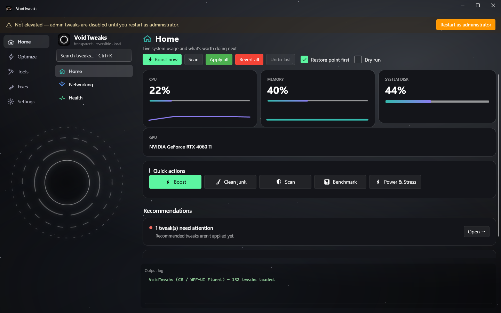
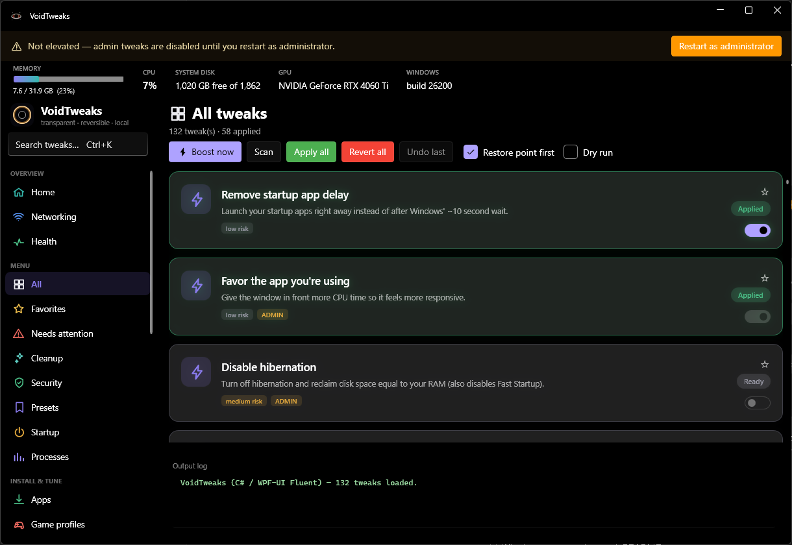
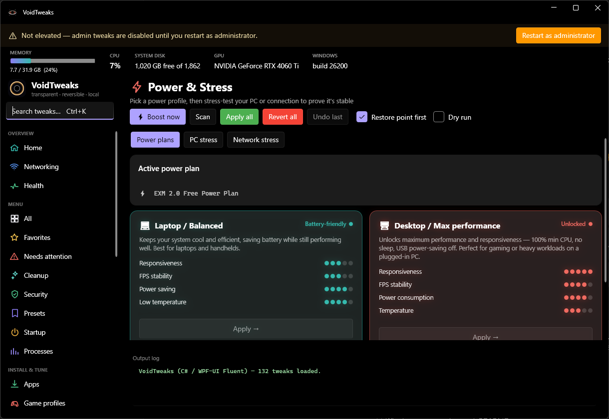
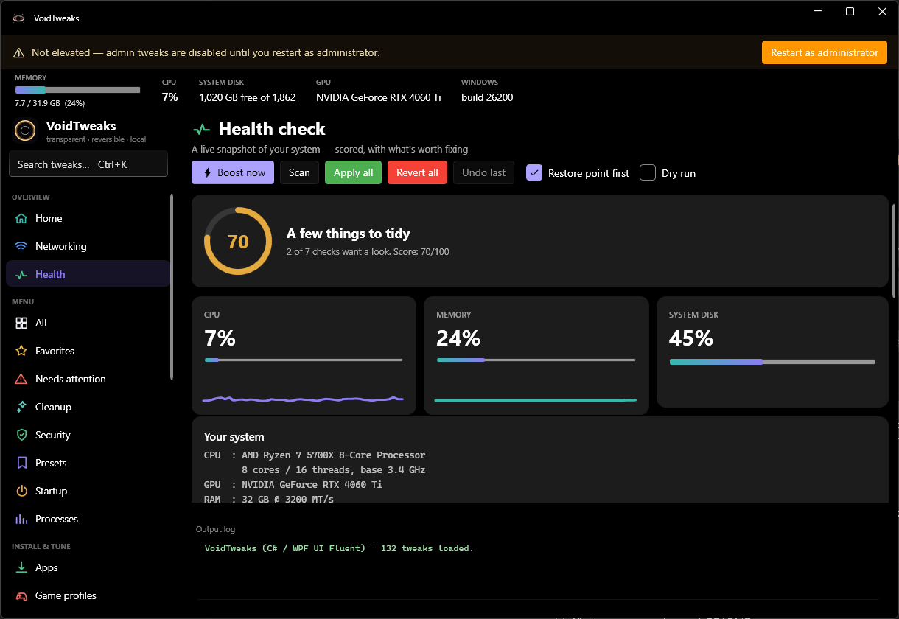
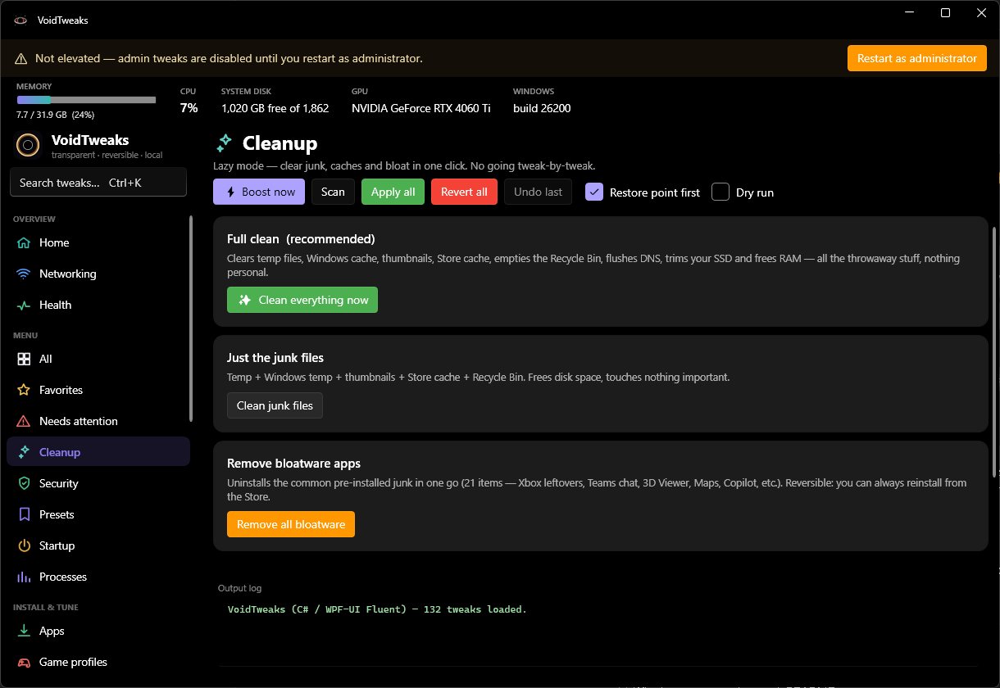
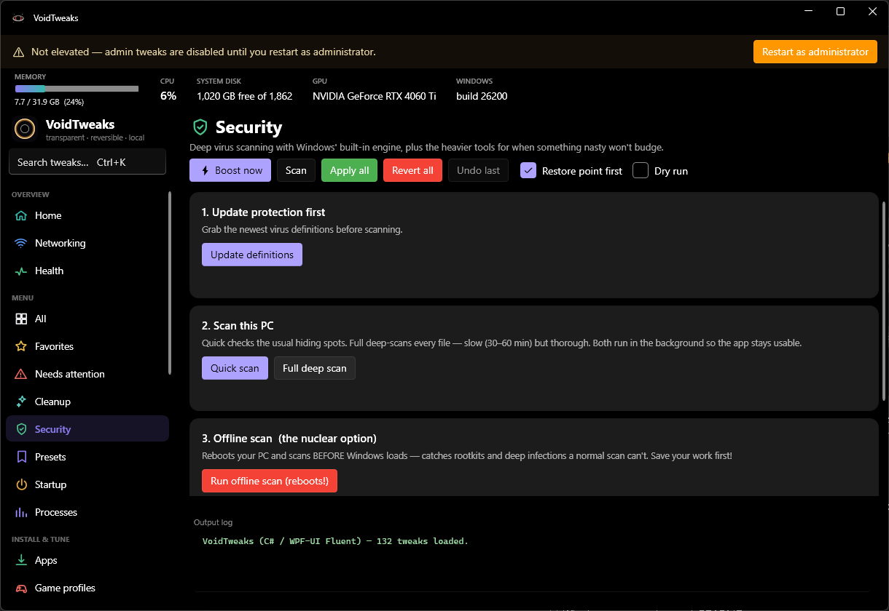

<div align="center">


# VoidTweaks

### An open, transparent, fully-reversible Windows 11 optimizer.

*Every change shown in plain language. Nothing hidden. Nothing phones home. One-click revert on almost everything.*

[](../../releases)
[](../../releases/latest)
[](LICENSE)
[](#)

<br/>

### ⬇️ [**Download the latest release**](../../releases/latest) &nbsp;·&nbsp; 💬 [Report a bug](../../issues) &nbsp;·&nbsp; ⭐ Star if it helped!


</div>

---

## 🔥 Why VoidTweaks?

> **I made VoidTweaks to pull together the functions you'd find across the usual paid Windows-tweaking apps — and make it ALL FREE AND OPEN-SOURCE.**
> Because I hate (and I'm sure you do too) wasting money on a tool we'll use once or twice a month. 🫡

Most "PC optimizers" are closed boxes: they hide what they change, nag you to pay, and sometimes leave your system worse than they found it. VoidTweaks is the opposite:

| | |
|---|---|
| 🔍 **Fully transparent** | Every tweak's exact commands live in [`tweaks.json`](tweaks.json) and show in a tooltip. No hidden actions. |
| ↩️ **Reversible** | Almost everything is a toggle — apply and revert in one click. A restore point is offered before changes. |
| 🔒 **100% local** | No telemetry, no accounts, no network calls except checking for updates and the tests you run yourself. |
| 💸 **Free & open-source** | MIT licensed. No paywall, no "Pro" upsell, no feature held hostage. |
| 🪶 **Self-contained** | One `.exe`. .NET is **not** required on the target PC. |

> ⚠️ **Use at your own risk.** These are real system changes. Keep **"Restore point first"** ticked (on by default) and only apply what you understand. The authors are not responsible for any damage.

---

## 📸 A look inside - V2.6

<div align="center">

| Home — live usage & recommendations | Tweaks — green = applied, red = not |
|:---:|:---:|
|  |  |

| Power & Stress — plans + stress tests | Health — scored system snapshot |
|:---:|:---:|
|  |  |

| Cleanup — lazy one-click junk removal | Security — deep Defender scanning |
|:---:|:---:|
|  |  |

</div>

---

## ✨ Features

### 🏠 Home & Health
- **Home** — live CPU / RAM gauges with sparklines, system-disk usage, and smart recommendations tailored to your PC.
- **Health** — a **scored** (0–100) system snapshot with a health ring, live gauges, and checks for Windows Update, antivirus status, pending reboots, startup load, memory pressure and drive type — all computed in the background, no freezing.
- **System report export** — save a clean, shareable HTML with your specs, active power plan and every applied tweak. Great for forums or a before/after record.

### 🧩 130+ tweaks, grouped by purpose
Performance · Gaming · Privacy · Network · Visual · Explorer · Advanced · Services · AI & Bloat · Debloat · Fixes · Updates · Maintenance.
Each card **glows green when applied, red when not**, shows its risk level, and reveals the exact commands it runs. **★ Favorite** any tweak to pin it to the Favorites tab.

### ⚡ Power & Stress *(new)*
- **Power plans** — one-click **Laptop / Balanced** and **Desktop / Max performance** profiles, with a reset to stock Balanced.
- **PC stress test** — pins every CPU core at 100% for 30 / 60 / 120 s with a live load readout, to prove stability and cooling.
- **Network / Wi-Fi stress test** — sustained ping to any host with **jitter**, **packet loss** and an A+→C gaming grade.

### 🧹 Cleanup & Boost
- **Clean everything** in one click — temp, Windows cache, thumbnails, Store cache, Recycle Bin, DNS flush, SSD trim and RAM free.
- **Bulk debloat** — remove common pre-installed junk in one go (reversible from the Store).
- **Boost** — RAMMap-style standby-list + working-set cleanup.

### 🛡️ Security
Deep virus scanning with the built-in Windows engine — **quick**, **full**, or **offline (pre-boot)** — plus pointers to heavier community tools when something won't budge.

### 📶 Networking & 🎮 Gaming
- **Networking** — connection + DNS benchmark with region-tuned advice (Europe / Americas / Asia).
- **Game profiles** — one-click, reversible tweak sets per game type (Competitive FPS, AAA, online multiplayer, streaming, low-end).
- **Overclock** — plain-English benchmarks and **safe, spec-aware** tuning advice + a live NVIDIA GPU monitor. It never changes your clocks/voltages for you.

### 🧰 Quality of life
- **Restore points** — create, list and **delete** restore points, or open System Restore to roll back.
- **Startup manager**, **process manager**, **winget app installer**, **presets** (built-in + your own, export/import).
- **Themes** (dark / pure-black / soft dark / light), **accent colours**, **9 languages**, system tray, update checker, Discord Rich Presence (optional).

---

## ⬇️ Install

**Easiest — installer:** grab **`VoidTweaks-Setup.exe`** from the [latest release](../../releases/latest) and run it.

**Portable:** grab **`VoidTweaks-portable.zip`**, unzip, and run `VoidTweaks.exe` — no install. Keep the `.json` and `.ps1` files next to the `.exe`.

Both builds are self-contained — **.NET is not required**. For admin-only tweaks, right-click → *Run as administrator* (or use the in-app "Restart as administrator" banner).

---

## 🛠️ Build from source

Requires the [.NET 10 SDK](https://dotnet.microsoft.com/download).

```bash
cd VoidTweaksApp
dotnet build -c Release
# or a self-contained single-file exe:
dotnet publish -c Release -r win-x64 --self-contained true -p:PublishSingleFile=true
```

---

## ⚙️ How it works

| File | What it is |
|---|---|
| [`tweaks.json`](tweaks.json) | The full, human-readable catalog — every apply/revert command. |
| `OpenTweaks.Actions.ps1` | Shared PowerShell helpers (RAM cleanup, benchmarks, network tests). |
| `VoidTweaksApp/` | The C# / WPF-UI (Fluent) app. |
| `i18n.json` | Translations for 9 languages. |

Everything a tweak does is visible in `tweaks.json` — **no hidden actions**.

---

## ❓ FAQ

**Is it safe?** Every change is reversible and shown in plain language, and a restore point is offered first. Still — only apply what you understand.

**Does it phone home?** No telemetry, no accounts. It only talks to the network when *you* run a test, install an app, or when it checks GitHub for a new version.

**Will it break Windows Update / my PC?** No tweak blocks updates unless you explicitly apply one that does, and it's reversible. Keep "Restore point first" on.

**Antivirus flagged the download?** Self-contained single-file apps that touch system settings sometimes trip heuristics. The full source is right here — build it yourself if you prefer.

---

## 🤝 Contributing

Issues and PRs welcome — new tweaks (add them to `tweaks.json`), translations, and bug reports especially. If you found VoidTweaks useful, a ⭐ genuinely helps it reach more people.

## 📄 License

[MIT](LICENSE) — free to use, modify and share.
